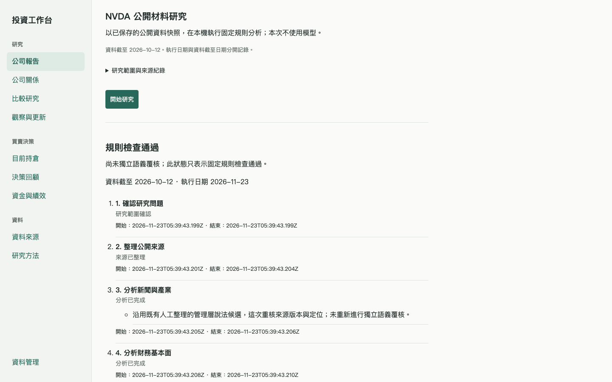
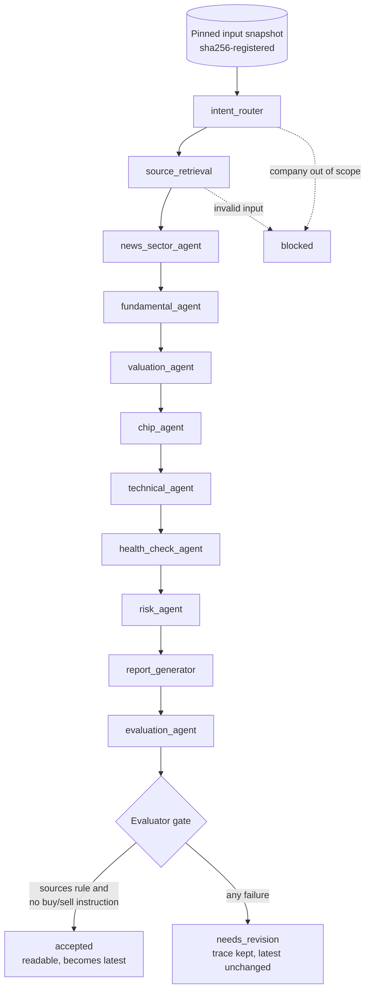
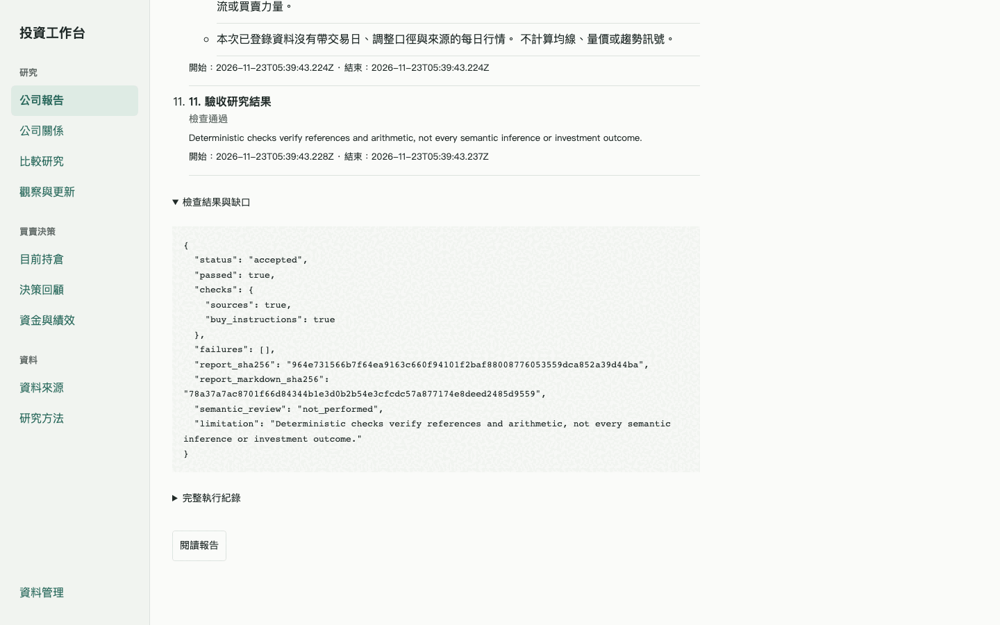
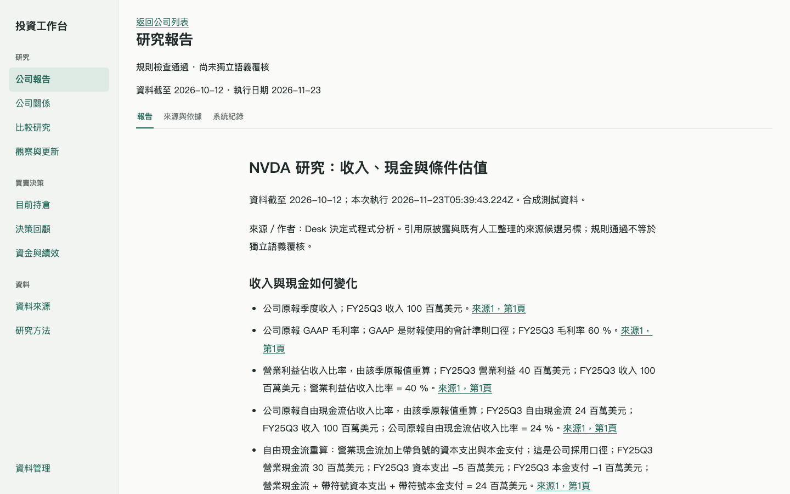
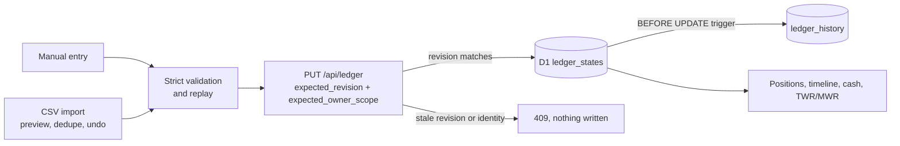
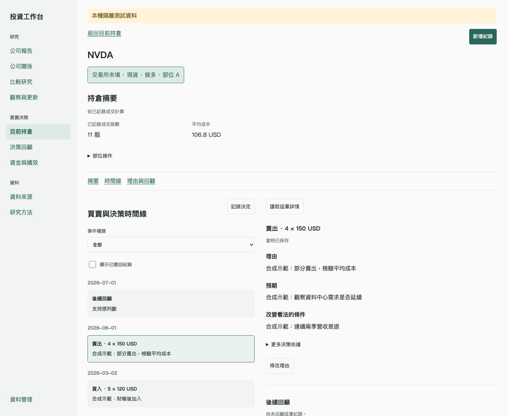

# Investment Research Desk



**A research and decision workbench: a deterministic 11-stage research pipeline with an evaluator gate, plus a trade ledger with whole-ledger version checks.**

Built with Vue 3, Vite 8 and plain ES modules; the API runs as a Worker over a D1 (SQLite) table. The UI is in Traditional Chinese. Every screenshot in this README uses synthetic fixture data.

## What it does

- **Runs research as code.** A fixed orchestrator runs 11 stages over a pinned, hashed input snapshot. Each stage stores its input, output and SHA-256 hashes. No stage calls a language model.
- **Gates every report.** The evaluator accepts a report only if every important claim cites a registered source with a matching hash and locator, every number matches the input facts or re-derives from them, quotes appear verbatim in the source within a word budget, and the authored text contains no direct buy or sell instruction. Otherwise the run ends as `needs_revision` and the "latest accepted" pointer does not move.
- **Reads financial evidence.** Multi-quarter financial and earnings-call bundles (`financial-research/1`) with exact decimal arithmetic, period alignment, coverage status and management-target outcomes.
- **Keeps a manual trade ledger.** Average cost including fees, partial sells, per-currency isolation, rejection of historical oversells, cash events (deposits, dividends, fees, taxes, splits, FX), and time- and money-weighted returns once enough data exists. CSV import offers preview, duplicate and conflict detection, and batch undo.
- **Links decisions to research.** Positions, a timeline of trades, decisions and reviews, the saved reasons and invalidation conditions behind each trade, and pins to the exact report version they relied on.

## Research pipeline

Stage names are the identifiers in `STAGES` (`src/research-pipeline/pipeline.mjs`).



| Rule group | What `evaluator.mjs` checks |
|---|---|
| Sources | Important claims (`fact`, `derivation`, `source_paraphrase`, `quote`) have evidence; each reference matches a registered document's text hash, URL and locator; fact bindings match the input facts; derivations recompute within tolerance and use comparable units and periods; quotes exist verbatim (≤ 25 words, per-document budget); limitations cannot smuggle in unregistered claims |
| Buy/sell instructions | All authored text (titles, claims, labels, assumptions) is scanned with a bilingual (Chinese/English) phrase rule; negated forms such as "not a recommendation" are allowed; quoted source text is excluded |





## Ledger



| Module | Responsibility |
|---|---|
| `src/ledger-core.mjs` | Record validation and replay: average cost with fees, per-ticker and per-currency books, oversell rejection |
| `src/portfolio-core.mjs` | Cash events, splits, FX, valuations, time-weighted and money-weighted returns |
| `src/csv-ledger.mjs` | CSV parsing, column mapping, duplicate and conflict detection, batch undo guarded by record hashes |
| `src/decision-workspace.mjs` | Position projection, decision journal, timeline |
| `worker/index.mjs` | `/api/ledger` GET/PUT, schema validation, whole-ledger compare-and-swap |

Dedicated crypto-exchange importers (spot, perpetual and trading-bot exports) are **designed but not implemented**; see [docs/exchange-import.md](docs/exchange-import.md).



## Quick start

Requires Node 26 and Pandoc (used to pre-render Markdown).

```bash
npm ci && npm run fixtures && npm test && npm run build
npm run dev
```

`npm run fixtures` writes synthetic report bundles, a synthetic hosting config (`.openai/hosting.json`, git-ignored) and the generated registry modules. It refuses to overwrite existing local inputs.

- **Research jobs in `npm run dev`.** The local research API (Vite middleware, loopback only) runs only when an input is registered under the git-ignored `.private/research-pipeline/`. The screenshots above came from registering the synthetic input in `tests/helpers/m1-input.mjs`. `npm run research:prepare` expects the owner's private source snapshot, which is not in this repository.
- **Ledger without a hosted backend.** After `npm run build`, run `mkdir -p .sites-runtime && node scripts/preview-workbench.mjs`. It serves `dist/` through the Worker with an isolated local SQLite database and a local sign-in stub at `/signin-with-chatgpt` (port 55558 by default; set `WORKBENCH_QA_DB` to use another database path).

## Design notes

- **Deterministic stages are code, not LLM calls.** Routing, retrieval, sector reading, fundamentals, valuation, gap checks, health, risk, report writing and evaluation are plain functions. When an input lacks a data class (for example daily prices or holdings data), the stage reports `not_evaluable` and says what is missing instead of producing a number.
- **Accepted means rule-checked, not semantically reviewed.** Each evaluation records `semantic_review: "not_performed"`. The instruction rule is an explicit phrase rule, not a classifier.
- **Reproducible runs.** Each run stores the input hash, the hashes of the pipeline source files, the per-stage trace and the evaluation. Reads re-check the accepted receipt, and retries with the same request ID return the same job.
- **Whole-ledger version checks.** All private state is one JSON document per owner. Every write sends `expected_revision` and `expected_owner_scope` and is applied with a single conditional SQL statement. Any mismatch returns 409 instead of last-write-wins, and a trigger keeps every previous revision.
- **Unknown stays unknown.** Missing prices, dates or quantities stay `null`. Returns are reported as "insufficient data" rather than estimated.

## Scope and limitations

- The owner's real ledger, research inputs and the evidence for the private research run are **not** in this repository. Everything here runs on synthetic fixtures, and the numbers in the screenshots are invented.
- The research pipeline currently registers a single company (NVDA) and replays a fixed data cutoff. It does not fetch live data.
- The hosted deployment depends on an owner-only hosting setup (authenticated identity header, D1 binding, hosting config), which is omitted. Locally that configuration is synthetic.
- Design notes and specs in `docs/` and `openspec/` are mostly in Traditional Chinese.
