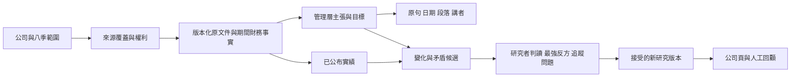

# 資料契約與架構取捨

以下為待開發的 `financial-research/1` 概念契約；不是現有 schema，也不是可直接匯入正式資料的 JSON。第一階段以本機不可覆寫的資料包與可重建索引實作，不新增資料庫服務。

## 核心鏈

文件、主張、目標、評估皆有獨立ID／版本。新事實可觸發待核工作，不能直接更新原判斷或覆寫原始期限。

## 實體與必要字段

| 實體 | 必要欄位與約束 |
|---|---|
| `company` | canonical company_id、legal_name、識別碼系統和值（CIK／台灣公司代號）、身份核對來源；沿用現有issuer mapping。`securities[]` 另記市場、交易所、share_class、currency、valid_from/to。公司不是ticker，也不是私人部位 |
| `research_run` | run_id、schema_version、company_id、question、requested_period_ids、as_of、as_of_mode、created_at、input_manifest_sha256、transform/model/prompt版本、費用／token計數、status、errors、review_refs |
| `period` | period_id、fiscal_year、fiscal_quarter、label_as_reported、start_date、end_date、days、52/53週制、duration/instant、consolidation_scope；不得由檔名或研究版次推財季 |
| `periodic_statement` | statement_id/version、company_id、period_id、statement_type income/balance_sheet/cash_flow、filing/release類型、audited/reviewed/unaudited、accounting_basis、document_version_id、fact_ids、as_reported/recast、supersedes；一份半年報可含多個不同duration與instant facts，不能把整份文件只當單季 |
| `coverage_cell` | company_id + period_id + required_material_type、candidate_urls、status、fetch/read/review狀態分開、read_spans、total_spans、excluded_reason、gap_impact、document_version_ids。status區分未發布、未找到、不可取得、只得目錄、只讀片段、已取全文、已核；有檔不等於已讀 |
| `source_document` | source_id、document_version_id、publisher、rightsholder、title、source_type、language、original_url、upstream_group、accession/公告ID、document_date、published_at與precision/timezone、first_seen_at、retrieved_at、revised_at、supersedes、raw_sha256、text_sha256、extraction_version、access_status、rights_policy、rights_checked_at、allowed_storage/use/display、license_url |
| `document_segment` | segment_id、document_version_id、heading_path、page/paragraph/line或audio start_ms/end_ms、speaker_id/role、section_kind prepared_remarks/qa_question/qa_answer/financial_table/other、原始文字、raw_text_offset、normalization_map、language；分段不能切斷數字與單位或Q&A問答 |
| `financial_fact` | fact_id、company_id、period_id、concept/原XBRL tag、metric_definition_version、raw_value原字串、numeric_decimal、currency、scale、unit、GAAP/IFRS/non_GAAP、consolidated/segment與dimensions、duration/instant、原context_id、decimals/rounding、source_document_version、locator、published_at、restated_as_of、revision_reason、derived_from、formula_version |
| `management_claim` | claim_id、claim_version_id、topic、claim_kind actual/guidance/aspiration/causal_explanation、statement_at、period_referred_to、speaker、scope（產品／客戶／地區／分部）、原句evidence_refs、研究者中文paraphrase、conditions、modality、review_status；「樂觀」等语氣不成為actual |
| `management_target` | target_id、origin_claim_version_id、KPI及定義、comparator、value/range、unit/currency、baseline_fact_id／原基準值、target_period、original_deadline、deadline_precision、conditions、target_kind quantitative/qualitative、uncertainty、superseding_target_id。模糊「未來」不硬填日期 |
| `evidence_link` | from_entity/version、document_version_id、segment_ids、exact_quote（獲准範圍）、quote_sha256、locator、role supports/contradicts/context、support_scope、limitations、translation單獨欄、quote_match_status、reviewer、reviewed_at；hash證明身份不證明語義 |
| `actual_outcome` | outcome_id、target_id、evaluation_as_of、eligible_fact_ids、comparison_formula、comparable=true/false、status pending/not_due/met/partly_met/missed/exceeded/withdrawn/redefined/not_disclosed/not_comparable/disputed、comparison_result within_range/above_range/below_range、理由、差距／容差、reviewer、version、supersedes；未揭露不能判失敗；`exceeded`＝實績高於區間上限，指引作為預測未命中但不等於營運失敗（2026-10-13 向後相容新增） |
| `change_candidate` | before/after claim_version_ids、change_type numeric/scope/timing/condition/wording/omitted/new、metric對齊結果、potential_contradiction、support/counterevidence、gap、研究者accepted/rejected/unresolved、reason；字面diff不等於矛盾成立 |
| `analyst_assessment` | assessment_id/version、原report pin、run pin、analyst與created_at、information_cutoff、accepted_evidence_refs、主判斷／因果、最強替代解釋、未識別項、三個follow_up_questions、judgment_change及reason、review_status；不可由新claim自動覆寫 |
| `follow_up` | id、question、linked_claim/target、requested_source、expected_event/deadline、support_rule、falsification_rule、priority_reason、status；日期是紀錄，不建立排程 |
| `model_scenario` | scenario_id/version、conservative/base/optimistic、自訂名稱、horizon、actual_input_fact_ids、assumptions及來源／理由／date、formulas、output、currency/unit/share_basis、invalidation、unmodeled_items、price_observation_id；情境不代表機率 |

每個版本記內容hash及前版ID。可空字段明示 `null`＋原因，不能拿0、檔案mtime、下載日補未知原始值。第三方全文只在合法授權範圍內保存；權利不明則保留 metadata、短引與連結，`raw_sha256=null`。若實際只取得工具抽取文字，文字hash不得冒稱原PDF bytes hash。

## 時點與修訂的兩種讀法

`period_end`是營運期間終點；`published_at`是外界能看到該版本的時間；`retrieved_at`是本次取回時間；`created_at`是本系統建檔时间。四者不能互換。

1. **公開資訊截至某日**：可用於當時公開資訊重建。只選 `published_at <= as_of` 的版本，且有可信證據能證明當時版本的內容。現在抓到的網頁若可能覆寫過，不能僅憑頁面舊日期認定它當時已如此。取得較晚的穩定SEC原申報可以用，但標明這是事後重建。
2. **使用者當時實際研究**：只用原決定pin與當時run／evidence版本；晚取回的材料不得回填成使用者當時已讀。預測评估還須預測created_at早於結果發布，否則是retrospective。

只有日期、缺精確時間時，記 `precision=day`。盤中as-of不能默認午夜可知；須保守排除或由已知公告時區/事件時間核對。API的filed日期不足以判定盤中先後，必要時回申報acceptance timestamp。未來as-of或負duration應拒絕。

修訂版另建document/fact version；提供「當時公布」與「目前重列」兩種檢視。原決定仍指舊hash。8-K與10-Q中的相同數字屬同上游，可做一致性檢查，不算兩個獨立營運確認。跨來源相同原文用hash去重，內容不同但同事件以upstream_group標記，不能丟掉修訂。

## 數字可比與重算規則

- 金額使用decimal字串與顯式scale，原報「USD millions」同時保留原值／呈現值；台幣／美元資料不能直接相加。換匯必須有日期、匯率來源及使用目的，P0不做跨幣別合併。
- 單季、累計、全年、TTM、期末餘額分開。流量科目只有在相同範圍、單位、會計與重列版本下才可由FY減9M推Q4；**EPS、利潤率、平均股數與資產負債餘額不可直接相減**。TTM只加四個不重疊季，推導值保留公式與父facts。
- 毛利率 = 毛利／營收；營益率 = 營益／營收。分母0／缺值输出null；原報小數位建立容差，不使用一刀切的1%容差。負數不歸零。
- diluted weighted-average shares、basic shares、期末shares、ADS比率、拆股調整分開。EPS有原報值與重算值；拆股前後須同基準才比較，並存corporate_action來源與有效日。不能同時調整已重列EPS及股數而重複拆股。
- GAAP與non-GAAP各存；每期排除項映射與調節表保留。公司改non-GAAP定義、改分部或重編前期時建立新metric_definition_version，不能把變更視為自然成長。
- CapEx必須註明設備付款、融資租賃取得或公司自訂口徑；FCF引用公司定義／自定公式，避免重扣租賃與現金投資。季節性與不同季度天數是解釋條件，不由模型自動消除。

三情境模型採相同核心式：`Revenue = Σ(driver_volume × driver_price)`或逐分部增長假設；`GrossProfit = Revenue × GM`；`OperatingIncome = GrossProfit − OpEx`；`Pretax = OperatingIncome + net_other_income`；`CommonNetIncome = Pretax − tax − NCI − preferred_dividends`；`EPS = CommonNetIncome / diluted_weighted_average_shares`。稅率／一次性項／虧損時另列處理，不能假定負所得必有同額稅益。`ValuePerShare = EPS × assumed_PE`僅在正盈利與同期限、同口徑下作條件試算，否則顯示不適用；EV倍數需另列淨債務／少數權益等橋接。所有假設倍數皆標「研究者假設」，沒有授權共識資料就不填市場共識。保留需求、產品mix、CapEx／營收的交互約束，不能把每項樂觀值無條件疊加。

## 目標達成與矛盾的裁決

先核 KPI、時間、對象、單位、會計定義，再比較。deadline過去但actual未公布仍是pending；「未揭露」和「沒有發生」不同。達標範圍含不確定數字／條件時使用partly_met或disputed，不強迫二元判決。管理層後來改目標，原target仍按原deadline評估，另有新target；「公司撤回目標」與「原目標是否達成」可以同時記錄。這是可爭議的研究標註，不做管理層誠信排名。

同時存在兩種解釋時保存兩者與可区分它們的下一證據。每個重大判讀至少列最強反方，或明記已查範圍內未取得合格反證；不得為湊反方偽造來源。核對不同時間／口徑後，才允許把change升為contradiction。

## ASR與引用品質

官方IR寄存稿也要核真正作者、編輯版本及權利，不能標為公司自撰。只有合法可取得且允許處理的音訊才送ASR；權利未清楚則保留人工筆記／連結選項。prepared remarks与Q&A分區；分析師提問不是管理層承諾。

保存音訊版本／hash、時間區間、模型／語言、speaker diarization候選、專名詞表、人工修正diff。ASR的confidence/logprob不是語義正確率；模型未提供就填unknown。採風險字段覆核：數字、幣別、百分比、正負、日期、產品與人名全部對照原音與財表；關鍵低信心段落需要人工重聽才可成為evidence。講者未知不猜CEO。

`lossless match`分兩層：原bytes有就驗hash；原句對抽取文字作精確substring比對。PDF連字、OCR與換行正規化必須保留反向offset map；若需改字才匹配，標示修正並核原頁，不默默模糊配對。翻譯與摘要都不是exact quote；hash一致也不表示翻譯忠實或因果成立。

## 儲存、索引與模型流程

| 方案 | 本計畫選擇與理由 |
|---|---|
| 既有JSON bundle＋hash＋按公司分檔 | **P0採用**。raw（在授權本機位置）→ normalized → reviewed → site projection分層；manifest綁版本，發布內容最小化。根索引只放摘要与檔案指標 |
| 現有 token overlap／全文索引 | 先用company/period/as-of/material/topic精確篩選，再用全文詞匹配。必要時本機SQLite FTS作可丟棄索引；選此項不是本輪安裝許可 |
| RAG | 作定位與回答草稿助手；回答必須返回可核source版本及原句。不把top-k結果稱完整八季已讀；coverage由獨立遍歷的收據產生。先設金標查詢再評估是否值得引入 |
| 向量庫 | P0不採用。只有跨語言檢索miss確實影響可量測recall時，才比較本機embedding方案、成本／隱私／版本。不把similarity當事實支持 |
| llm-wiki | 可作由接受facts生成的一頁公司閱讀投影；每段保存依據／生成版本。原始source/claim為權威，wiki可重建，禁止直接改摘要再回寫事實 |
| Neo4j | 不採用。現有relations JSON及company IDs足以連來源／關係；尚無多跳查詢效能瓶頸證據，不新增圖資料庫維運 |

未來手動執行流程：來源清單與權利檢查 → 有界取得 → 決定式解析／單位核對 → 單期主張候選 → 跨期對齊 → 獨立研究者核重大數字、語義和反方 → 使用者接受 → 原canonical新版本 → site projection。可委派互斥來源批次；一個整合writer，每個claim由證據裁決。多模型同意不是投票通過，多數模型仍可能讀錯同一原文。所有外部內容當資料，不能觸發工具、執行內嵌指令或擴大來源白名單。

增量更新以document_version hash與parser/model/prompt版本快取：相同原件與相同設定直接復用；新季或修訂只使依賴它的fact/claim/model失效。保留未受影響版本、失敗紀錄、取消狀態、input/output pin和cost receipt。不能用新parser重算時覆蓋既有quote locator。
